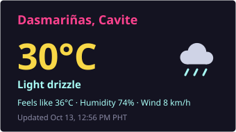
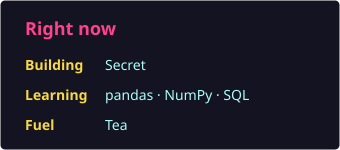

<table>
	<tr>
		<td width="20%" valign="top">
			
		</td>
		<td width="70%" align="left" valign="top">
			<h1>Hi, I'm Ken</h1>
			

				Aspiring <strong>Data Scientist</strong> from the Philippines 
				Web Developer · Cybersecurity Enthusiast
			

			

				I build small systems with intention, learning how data, software, and infrastructure fit together. 
				Currently exploring the intersection of backend development, data analysis, and security.
			

		</td>
	</tr>
</table>

---

## Contact

- **Email**: cantigakenlester@gmail.com  
- **LinkedIn**: [linkedin.com/in/ken-cantiga](https://linkedin.com/in/ken-cantiga)  
- **Facebook**: [facebook.com/kenlester.cantiga](https://facebook.com/kenlester.cantiga)
- **Twitter**: [twitter.com/Be1l_ai](https://twitter.com/Be1l_ai)

---

## Tech Stack

<table>
<tr>
<td valign="top">

**Languages:**

**Frameworks & Libraries:**

**Tools & Platforms:**

**Gitroll and Coding Style:**

	

</td>
<td valign="top" align="center">

**Dashboard:**

</td>
</tr>
</table>

---

## Featured Projects

<strong>Click to expand</strong>

### Study Bot — PDF to Timed Study Sessions
A Telegram bot that turns any PDF into a study session. It splits the text into topics, rewrites each one with an LLM without changing the facts, sends them on a timer, then deletes the topic and quizzes you. Pass the quiz and the topic counts as learned; fail and it comes back. Deployed on Render.

**Tech**: Python, SQLite, Telegram Bot API, Groq API (Llama 3.3 70B)

---

### Movie Player — Web-Based Streaming App
A browser-based movie streaming application featuring search functionality and direct playback. Designed for seamless media consumption with a clean, responsive interface.

**Tech**: Python, Flask, JavaScript, Tailwind CSS, OMDb API

---

### Student Management — Desktop System
A comprehensive desktop application for managing student records, courses, grades, and generating academic reports. Built with PyQt6 for a native application experience.

**Tech**: Python, PyQt6

---

### Room Reservation Database — Campus Room Booking
A relational database design for booking shared campus rooms (classrooms, labs, study halls). Covers users, rooms, room features, bookings, check-ins and staff verification, with seed data and sample queries.

**Tech**: SQL, SQLite

---

<table align="center">
<tr>
    <td></td>
    <td></td>
</tr>
<tr>
    <td></td>
    <td></td>
</tr>
</table>

---

### Code Compilation & Experiments
A growing collection of Python projects and small tools built while exploring programming fundamentals, algorithms, and software design patterns.

---

## Currently Learning

<strong>Expand to see what I'm working on</strong>

### Data Science Foundations
- Learning statistical analysis and probability theory
- Trying to be comfortable at data manipulation with pandas and NumPy
- Exploring data analysis and visualization techniques
- Exploring data cleaning and organization

### Frontend Development
- Responsive design principles and mobile-first approach
- Learning modern Vanilla JavaScript, DOM manipulation, 3d models, animation, and components separation
- Studying CSS frameworks and component-based architecture

### Security & Systems
- Cryptography basics: symmetric/asymmetric encryption, hashing
- Studying steganography techniques and digital forensics
- Learning network security fundamentals and secure coding practices

### Linux & DevOps
- Ubuntu system administration and shell scripting
- Docker containerization and orchestration
- Environment management and automation workflows

---

## GitHub Stats

<strong>My github records and stats</strong>

<table align="center">
<tr>
    <td align="center">
        
    </td>
    <td align="center">
        
    </td>
</tr>
<tr>
    <td colspan="2" align="center">
        
    </td>
</tr>
</table>

---

  

  

  <i>Always learning something new!</i>

